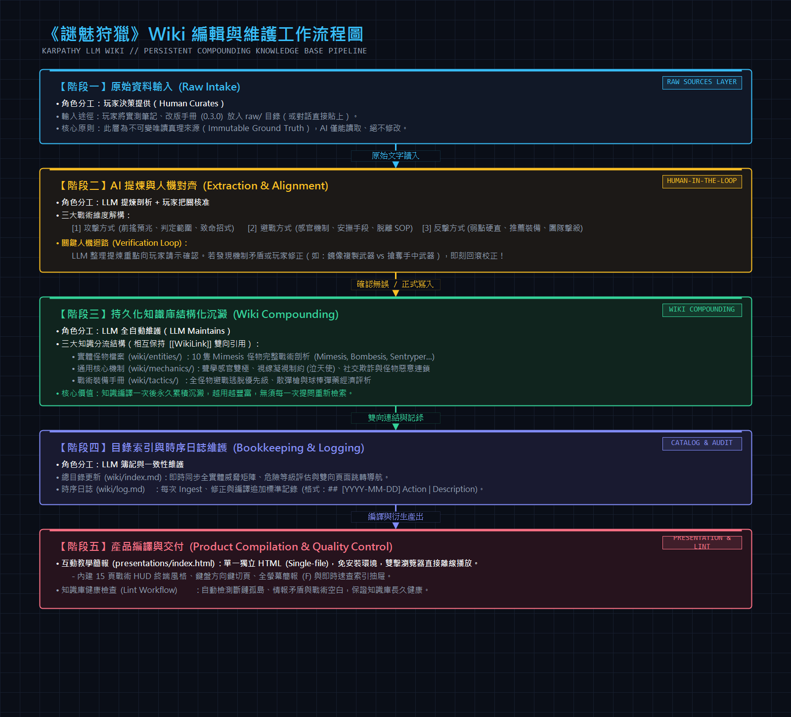

# 《謎魅狩獵》(Mimesis) 戰術知識庫與互動教學簡報

> 本專案基於 **Karpathy LLM Wiki** 模式構建，將《謎魅狩獵》中 10 隻 Mimesis 變種怪物的實測筆記，結構化提煉為持久沉澱的網狀知識庫，並自動編譯為**可直接在線瀏覽的單一檔案戰術 HUD 互動教學簡報**。

---

## 🎮 在線互動簡報 (Live Demo)

啟用 GitHub Pages 後，可透過以下網址直接在線全螢幕播放教學簡報：

🔗 **[點此在線瀏覽教學簡報 (GitHub Pages Live Demo)](https://<你的GitHub帳號>.github.io/<你的倉庫名稱>/)**

*(若已在 GitHub 開啟 Pages，將 `<你的GitHub帳號>` 與 `<你的倉庫名稱>` 替換為你的 Repository 即可以任何瀏覽器無縫播放！)*

- **鍵盤控制**：`←` / `→` 切換投影片、`Space` 下一頁、`F` 切換全螢幕簡報、右上角 `📑 速查索引` 呼出 15 頁戰術目錄。
- **純靜態架構**：Single-file HTML，無需安裝 Node.js 或依賴任何第三方框架。

---

## 📊 Wiki 維護與編輯流程架構

本專案遵循「人類決策把關，LLM 結構化維護」的永續沉澱模式：



---

## 👾 10 大 Mimesis 怪物實體威脅速查 (Threat Matrix)

| 編號 | 怪物名稱 (中/英) | 危險等級 | 核心攻擊特點 | 最佳避戰 SOP | 推薦反擊武器 |
| :---: | :--- | :---: | :--- | :--- | :--- |
| **01** | **Mimesis (模仿者/假人)** | ★★★★☆ | 掐脖高感染 (50-80%)、**鏡像複製物品欄武器反打** | 確認假隊友破綻後立即狂奔拉開 | 霰彈槍 1 發 / 搖滾球棒 2 下 |
| **02** | **Bombesis (炸彈魔)** | ★★★★☆ | 逼逼聲倒數、區域致命自爆 | 留滿體力，聞聲立刻全速狂奔 | 遠程霰彈槍 1 發 (嚴禁近戰) |
| **03** | **Brute Bunny (野蠻兔)** | ★★★☆☆ | 壯碩突進、兩下致命 | **開麥大聲說話 / 尖叫嚇跑** | 霰彈槍 3 發內收走 |
| **04** | **Mama Monkey (猴子媽媽)** | ★★☆☆☆ | 拖人至出口、武器化假人砸人 | 隊友普通敲 1 下即刻中斷解救 | 霰彈槍 1 發 / 球棒 3 下 |
| **05** | **Quakka Glider (矮袋鼯鼠)** | ★★☆☆☆ | 滑翔撲臉、全屏黑屏與完全消音 (為自爆魔鋪路) | 冷靜靠牆，隊友一棒敲落 | 球棒 1 下即可擊落 |
| **06** | **Standing Owl (紳士貓頭鷹)**| ★★★☆☆ | 羽翼高速旋轉、一擊扇死 | 保持 3 米間距繞行 (不主動招惹不動) | 旋轉硬直期球棒 2 下 / 霰彈 1 發 |
| **07** | **Maegoostro (沉默指揮家)** | ★★☆☆☆ | 指揮棒敲頭 (對噪音極度暴怒) | **全體閉嘴、手持裝備保持完全靜音** | 霰彈槍 2 發直接轟殺 |
| **08** | **Heavy D (海維·D/DJ坦克)** | ★★★★☆ | 坦克衝撞擊飛物資散落 + 扣 50% 總血量 | 引導至崎嶇地形卡位後脫身 | **強烈不推薦打** (耗 6 發霰彈零收益) |
| **09** | **Sentryper (哨兵/雙鐮怪)** | ★★★★★ | 雙骨鐮鬼魅突進、**一刀必死** | **雙眼全程直視凝視 (泣天使機制)**，倒退後撤 | 雙人配合：一人凝視，一人遠程霰彈 2 發 |
| **10** | **Ramblam (雙槍羊)** | ★★☆☆☆ | 衝刺後定點長時間瞄準射擊 | 門口被堵時引導其開闊處瞄準後變向脫逃 | 瞄準射擊定點硬直期全力反殺 |

---

## 📂 目錄結構

```text
├── index.html                 # 根目錄 GitHub Pages 入口 (教學簡報)
├── docs/                      # 備用 GitHub Pages 目錄
│   └── index.html
├── presentations/             # 簡報產出層
│   └── index.html             # 現代化戰術 HUD 互動簡報主檔
├── wiki_workflow.png          # Wiki 維護流程圖
├── AGENTS.md                  # LLM Agent 維護規範與 Schema
├── raw/                       # 【唯讀原始來源層】玩家原始筆記與攻略文本
└── wiki/                      # 【持續演化維基層】
    ├── index.md               # 知識庫總目錄
    ├── log.md                 # 時序變更日誌
    ├── entities/              # 10 隻 Mimesis 怪物獨立檔案
    ├── mechanics/             # 核心機制 (聲學雙極、視線鎖定、社交欺詐、怪物連攜)
    └── tactics/               # 戰術手冊 (全怪物避戰 SOP、彈藥經濟學)
```

---

## 🚀 如何開啟 GitHub Pages（3 步驟一鍵在線預覽）

1. 將本專案推送到你的 GitHub 儲存庫（Repository）。
2. 在 GitHub 儲存庫頁面，點擊上方選單的 **Settings**（設定）$\rightarrow$ 側邊欄點選 **Pages**。
3. 在 **Build and deployment** 下方的 **Branch**：
   - 選擇 `main`（或 `master`）分支。
   - 資料夾保持選擇 `/ (root)` 或 `/docs`。
   - 點擊 **Save**（儲存）。
4. 稍等約 30 秒至 1 分鐘，重新整理頁面，頂部即會出現你的專屬線上網址：  
   `https://<username>.github.io/<repo-name>/`，點擊即可在全螢幕戰術 HUD 中瀏覽教學簡報！
